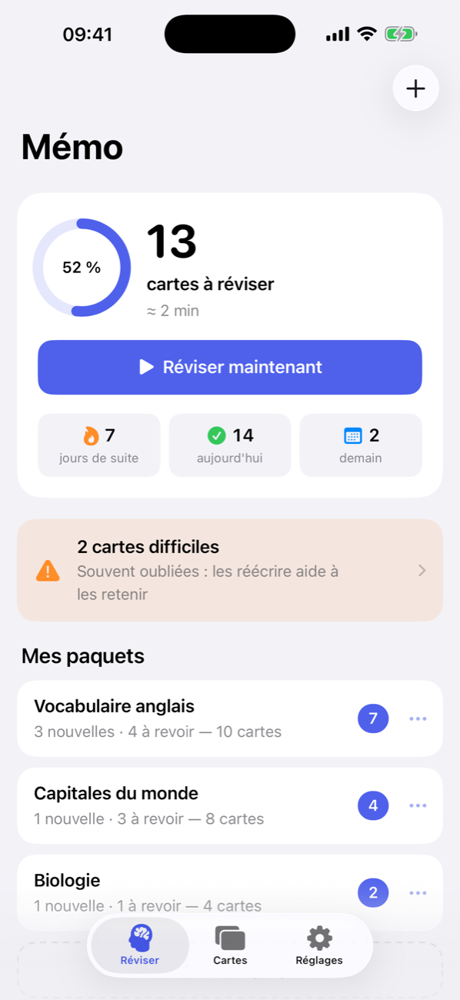
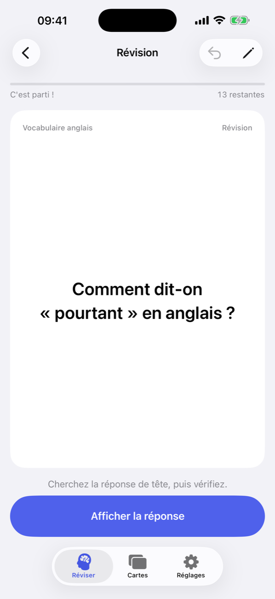
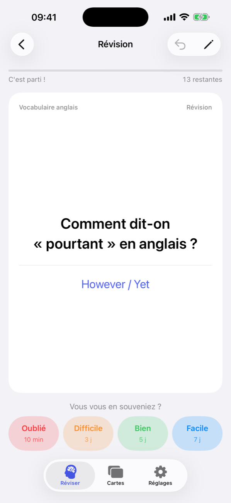
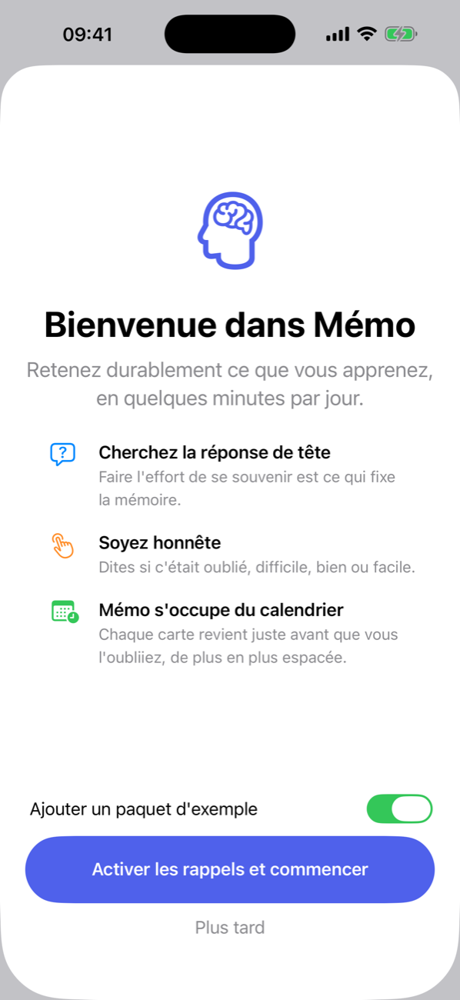
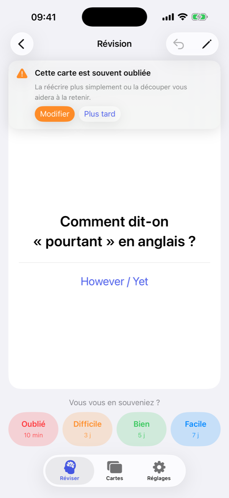
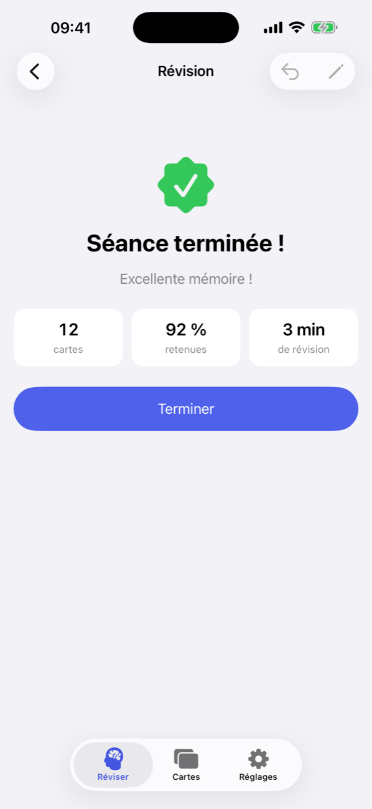
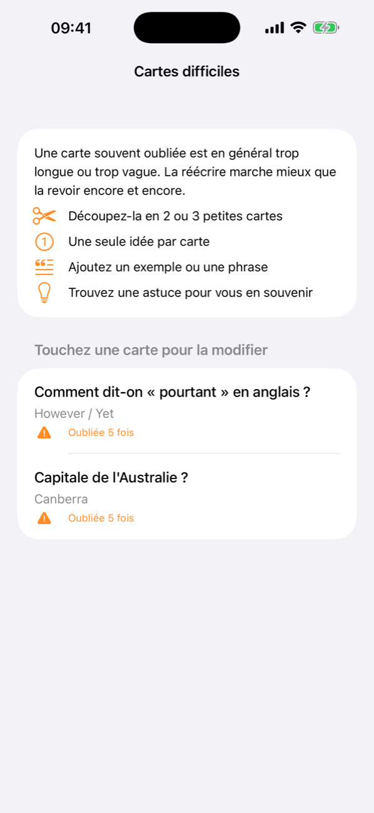
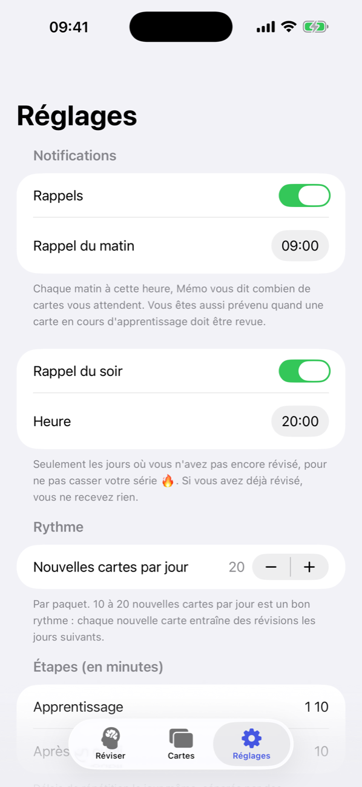
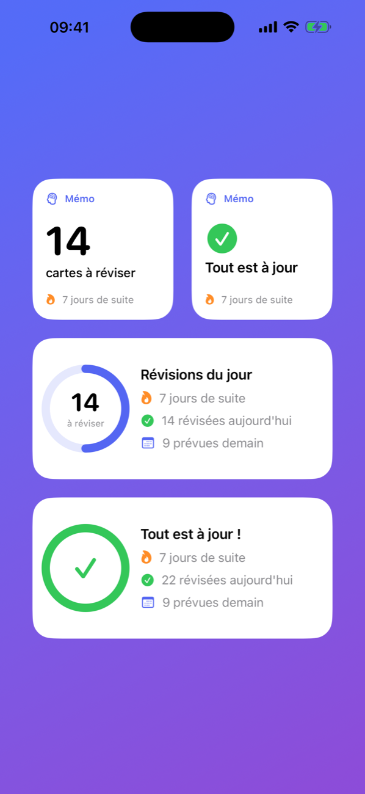

# Mémo

A simple, native iOS flashcard app built around one idea: **spaced repetition**. Write question / answer cards, review them for a few minutes a day, and Mémo brings each card back right before you would forget it.

Built with SwiftUI, SwiftData and WidgetKit. No account, no server: everything stays on the device.

> The app's interface is in French.

<p align="center">
  
  
  
</p>

## Features

**Reviewing**
- One big "Review now" button that studies all your decks at once, or tap a deck to study it alone
- Think of the answer, tap to reveal it, then rate yourself: **Forgot**, **Hard**, **Good** or **Easy**. Each button shows when the card will come back
- Undo your last answer, edit the current card, and get a light haptic tap on every answer
- An end-of-session summary with the number of cards, the share you remembered and the time spent

**Staying consistent**
- A daily progress ring, a streak counter and tomorrow's forecast on the home screen
- A morning reminder with the number of cards waiting
- An evening reminder, **only on days you haven't reviewed yet**, so you don't break your streak
- A notification at the exact moment a card in learning is due again
- An app icon badge with today's card count
- Home screen and lock screen widgets

**Better cards**
- **Difficult cards**: after 4 lapses a card is flagged, with tips to rewrite or split it (a card you keep forgetting is usually badly worded)
- Quick add: paste many cards at once, one per line (`question ; answer`)
- Search and filter all your cards by deck or difficulty

**Your data**
- Stored locally with SwiftData
- JSON export / restore from the settings

## Screenshots

| Welcome | Difficult card notice | Session summary |
|:---:|:---:|:---:|
|  |  |  |

| All cards | Difficult cards | Settings |
|:---:|:---:|:---:|
|  |  |  |

| Widgets |
|:---:|
|  |

## How the spaced repetition works

Mémo uses a variant of the SM-2 algorithm, close to the one used by [Anki](https://apps.ankiweb.net).

1. **Learning.** A new card is shown again after **1 minute**, then **10 minutes**, to anchor it.
2. **Reviewing.** It then comes back after **1 day**, then about **3, 8, 20, 50 days**… The gap grows each time you remember it.
3. **Forgetting.** "Forgot" sends the card back to relearning (10 minutes) and restarts its interval at 1 day.
4. **Per-card ease.** Each card has its own ease factor: hard cards come back more often, easy ones less often.

| Rating | New card | Card in review (interval *I*, ease *E*) |
|---|---|---|
| Forgot | 1 min | 10 min, then relearn; ease −0.20 |
| Hard | 6 min | about *I* × 1.2; ease −0.15 |
| Good | 10 min, then 1 day | about *I* × *E* |
| Easy | 4 days | about *I* × *E* × 1.3; ease +0.15 |

Reviews done late are taken into account. New cards are limited to 20 per deck per day by default (adjustable in the settings).

## Requirements

- macOS with **Xcode 26** or later, and the iOS 26 platform installed (Xcode → Settings → Components)
- An iPhone with **iOS 17** or later

## Getting started

### Run in the simulator
1. Open `Memo.xcodeproj`.
2. Pick an iPhone simulator in the toolbar.
3. Press **Run** (⌘R).

### Install on your iPhone
1. Add your Apple ID in **Xcode → Settings → Accounts**.
2. In **Signing & Capabilities**, select your team for **both** the `Memo` and `MemoWidgetExtension` targets.
3. Connect your iPhone, enable **Developer Mode** (Settings → Privacy & Security), select it in the toolbar and press **Run**.
4. The first time, trust the developer on the iPhone: **Settings → General → VPN & Device Management**.

With a free Apple account, apps installed this way expire after 7 days. Press **Run** again to reinstall: your cards and progress are kept.

## The "Patterns" deck

The app ships with a **Patterns** deck: one card per coding problem solved (NeetCode 150).

- **Front:** the problem statement in one sentence.
- **Back:** the pattern first, then the key idea in two lines. Never code.

To add newly solved problems, either add cards in the app, or add entries to `Memo/StarterDeck.swift` with a new `id`. On the next launch, only cards that were never imported are added, so nothing is duplicated and a card you delete in the app does not come back.

## Project structure

```
Memo/                     The app
├── Scheduler.swift         Spaced repetition algorithm (pure Swift)
├── StudyQueue.swift        Picks the next card, counts what is due
├── Models.swift            SwiftData models: Deck, Card, ReviewLog
├── Reminders.swift         Local notifications and app badge
├── WidgetSync.swift        Writes the widget's data to the shared App Group
├── Backup.swift            JSON export / restore
├── AppSettings.swift       Settings
├── StarterDeck.swift       Built-in "Patterns" deck: one card per solved coding problem
└── Views/                  SwiftUI screens
MemoWidget/               Home screen and lock screen widget
Shared/                   Code shared by the app and the widget
Config/                   Entitlements (App Group) and URL scheme
docs/screenshots/         Images used in this README
```

The widget reads a small summary that the app writes to the App Group `group.com.ilyasdahhou.memo` whenever the app goes to the background. Tapping the widget opens a review session through the `memo://review` link.
